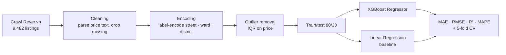

<h1 align="center">🏠 Ho Chi Minh City House Price Prediction</h1>

<p align="center">
  <b>Predicting residential property prices in Ho Chi Minh City from real listings with XGBoost</b>
</p>

<p align="center">
  
  
  
  
  
</p>

---

## 📌 Overview

House prices in Ho Chi Minh City depend on location, size and layout, which makes manual valuation slow and subjective. This project builds a regression model on **real listings collected from [Rever.vn](https://rever.vn/s/ho-chi-minh)** to estimate the price of a house from its location and basic characteristics.

## 📊 Results

**XGBoost Regressor** (test set, 80/20 split):

| Metric | Value |
|---|---|
| R² | **0.803** |
| 5-fold CV R² | **0.800 ± 0.007** |
| MAE | **1.01** billion VND |
| RMSE | **1.45** billion VND |
| MAPE | **17.0%** |

The 5-fold cross-validation scores (0.791 – 0.809) are very close to the test score, so the result is stable and does not depend on one lucky split.

**Baseline: Linear Regression** (district one-hot + bedrooms, bathrooms, area): R² = 0.503, MAE = 2.78, RMSE = 4.94 billion VND.

> The baseline was trained without the outlier filter and without street / ward, so it is a reference point rather than a strictly like-for-like comparison.

### Feature importance (XGBoost)

| Feature | Importance |
|---|---|
| Bathrooms | 0.291 |
| District | 0.190 |
| Bedrooms | 0.186 |
| Area (m²) | 0.179 |
| Ward | 0.081 |
| Street | 0.072 |

Size-related features (bathrooms, bedrooms, area) together explain most of the prediction, followed by district.

## 🗂️ Dataset

| Stage | Rows |
|---|---|
| Raw listings crawled from Rever.vn (townhouses, apartments, villas) | **9,482** |
| After cleaning (price parsing, missing values dropped) | **8,154** |
| After removing price outliers (IQR, k = 1.5; 660 rows, 8.09%) | **7,494** |

**Raw columns:** street, ward, district, listing code, update date, price, price per m², bedrooms, bathrooms, area, direction, description.

**Features used by the model:** `street`, `ward`, `district`, `bedroom`, `bathroom`, `area(m2)`. **Target:** `price` (billion VND).

> `price(m2)` is **not** used as a feature, because it is derived from the target (price ÷ area) and would leak the answer.

Data is used for research and educational purposes only.

## 🔄 Workflow



**Processing steps**
1. **Price cleaning:** listing prices are free text (for example "12.5 tỷ", "tỷVND", discount tags), so they are parsed into numbers in billion VND.
2. **Missing values:** rows missing price, area, bedrooms, bathrooms or price per m² are dropped.
3. **Column cleanup:** removed direction, description, listing code and update date.
4. **Encoding:** label encoding for street, ward and district (the tree model does not need one-hot).
5. **Outlier removal:** IQR rule on price, keeping 1.5 × IQR around the quartiles.

**XGBoost configuration:** 500 trees, learning rate 0.05, max depth 6, min child weight 5, gamma 0.1, subsample 0.8, colsample 0.8, L1 0.1, L2 1.0.

## 📁 Project Structure

```
├── data/
│   ├── house_prices.csv                       # raw crawled listings
│   ├── data-train-ml_house_prices.csv         # cleaned & encoded (XGBoost)
│   └── data-train-ml_house_prices-linear.csv  # cleaned (linear baseline)
├── notebooks/
│   ├── analysis.ipynb                         # exploratory data analysis
│   ├── processor.ipynb                        # cleaning & encoding
│   └── XGBoost.ipynb                          # training & evaluation
└── requirements.txt
```

## 🚀 Quick Start

```bash
pip install -r requirements.txt
jupyter notebook notebooks/
```

> The notebooks were run locally and on Google Colab. Update the CSV paths at the top of each notebook to point to the `data/` folder.

## 🔭 Future Work

- Log-transform the price and add hyperparameter search (Optuna / GridSearch)
- Geospatial features (distance to the city center, metro and schools)
- Text features from listing descriptions (legal status, furniture, frontage)
- More sources and multiple crawl dates for time-series trends
- Serve the model through a FastAPI / Streamlit app

## 👤 Author

**Nguyen Hong Nhat Linh** – AI Engineer · [GitHub](https://github.com/LinhNhat07) · nlinh.nh7@gmail.com
