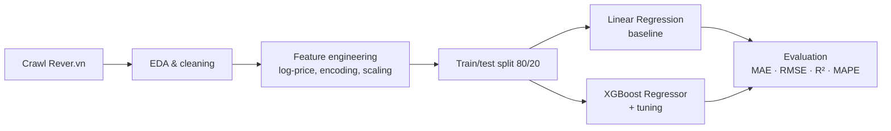

<h1 align="center">🏠 Ho Chi Minh City House Price Prediction</h1>

<p align="center">
  <b>Predicting residential property prices in HCMC with XGBoost (2026)</b>
</p>

<p align="center">
  
  
  
  
</p>

---

## 📌 Overview

House prices in Ho Chi Minh City depend on location, size, infrastructure and market trends, which makes manual valuation slow and subjective. This project builds a regression model on **real listings collected from [Rever.vn](https://rever.vn/s/ho-chi-minh)** to support automated price estimation and investment screening.

## 📊 Results

| Metric | Linear Regression (baseline) | **XGBoost** | Improvement |
|---|---|---|---|
| R² | 0.503 | **0.803** | +30 pts |
| MAE (billion VND) | 2.778 | **1.011** | −63.6% |
| RMSE (billion VND) | 4.940 | **1.453** | −70.6% |
| MAPE | – | **17.0%** | – |

XGBoost explains about 80% of price variance, with a mean absolute error of about 1 billion VND. Most of the gain over the baseline comes from capturing non-linear effects and feature interactions (district × area × property type), helped by log-transforming the price and filtering outliers.

## 🗂️ Dataset

- **Source:** crawled from Rever.vn (townhouses, apartments and villas in HCMC)
- **Size:** 9,481 listings → **8,821** after outlier removal (IQR on log-price, 660 rows / 8.09% dropped)

| Feature | Description |
|---|---|
| `street`, `ward`, `district` | Location |
| `price` | Total price (billion VND), **target** |
| `price(m2)` | Price per m² |
| `area(m2)` | Floor area |
| `bedroom`, `bathroom` | Number of rooms |
| `direction` | House orientation |
| `discount` | Discount, if any |
| `date_update` | Last update date of the listing |
| `code_housing` | Listing ID |
| `description` | Free-text description |

> Data is used for research and educational purposes only.

## 🔄 Workflow



## 📁 Project Structure

```
House_Price/
├── data/
│   ├── house_prices.csv                       # raw crawled listings
│   ├── data-train-ml_house_prices.csv         # cleaned training set (XGBoost)
│   └── data-train-ml_house_prices-linear.csv  # training set for the linear baseline
├── notebooks/
│   ├── analysis.ipynb                         # EDA & visualization
│   ├── processor.ipynb                        # cleaning & feature engineering
│   └── XGBoost.ipynb                          # model training & evaluation
└── requirements.txt
```

## 🚀 Quick Start

```bash
git clone https://github.com/LinhNhat07/House_Price.git
cd House_Price
pip install -r requirements.txt
jupyter notebook notebooks/
```

> The notebooks were originally run locally and on Google Colab. Update the CSV paths at the top of each notebook to point to the `data/` folder.

## 🔭 Future Work

- Geospatial features (distance to metro, schools, city center)
- Time-series analysis across multiple crawl dates
- Additional sources (Batdongsan, official land price tables)
- Serve the model through a FastAPI / Streamlit app

## 👤 Author

**Nguyen Hong Nhat Linh** – AI Engineer · [GitHub](https://github.com/LinhNhat07) · nlinh.nh7@gmail.com
